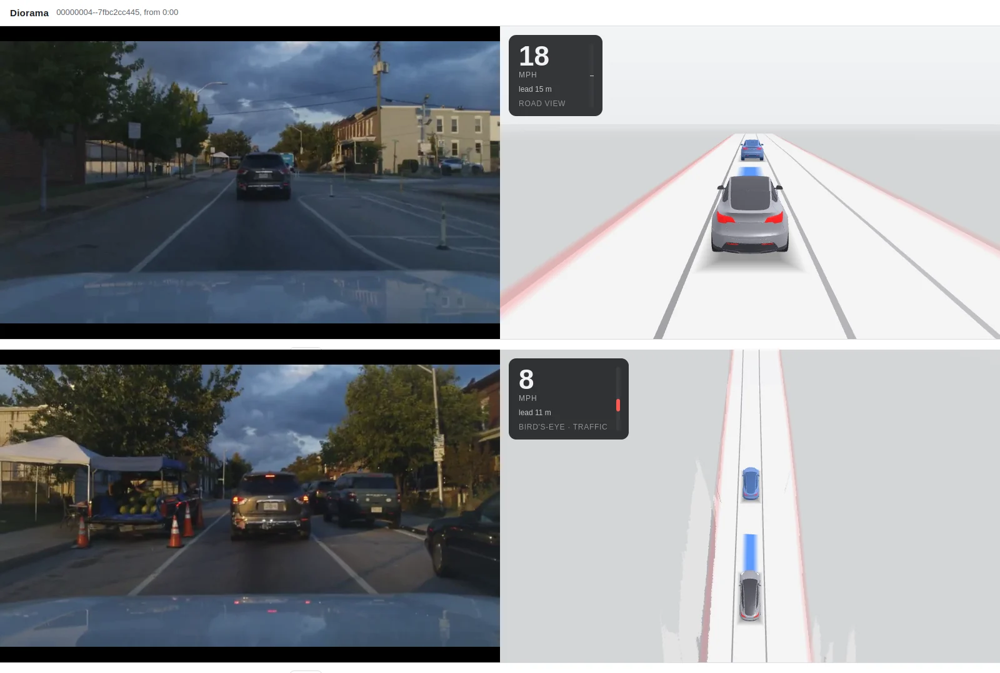

# Diorama

Diorama draws the drive as a live 3-D miniature, from what the driving model
sees. You get the planned path, lane lines, road edges and the road around
the car, and the lead car in blue. It is all computer-drawn: no camera footage
appears in it.

<a href="images/diorama.webp"></a>

It runs in four places, all with the same page:

| Where | How to open it |
| --- | --- |
| Jetson or Linux PC | `http://<host>:<status port>/diorama/` on the web page, with `--diorama` ([below](#live-on-a-jetson-or-linux-pc)) |
| Mac app | **Diorama** in the sidebar (⌘5) |
| iPhone app | the **Diorama** tab: watching a Mac nearby, or on the iPhone's own server ([below](#iphone)) |
| A recorded drive, on any computer | `python -m diorama view` ([below](#try-it-on-your-own-footage)), beside the drive's own footage |

## How it works

The comma already sends the server two things each frame: the warped narrow
camera image and the driving model's inputs. The server answers with the model's
outputs. Diorama adds one model that runs on the same warped image:
Mask2Former (Swin-L, Mapillary Vistas panoptic), on every other frame (10 Hz).
It segments the road surface, paint, crosswalks, curbs and sidewalks.

The page does the rest, in the browser:

- It builds a road map around the car from the segmentation.
- It draws the lead car from each driving-model frame on its own: a car with
  its rear at the model's lead distance and offset, facing along its lane,
  with brake lights when the model predicts it braking. It is drawn only when
  both agree there is one:
  - the model's lead probability is over 50%, and
  - the newest segmentation, at most half a second old, has a vehicle at the
    lead's spot in the frame, standing on the road within 25% (or 3 m) of the
    model's distance.

  Without a segmentation (while it is prepared, or paused after a slow
  driving frame) no lead is drawn. Nothing is tracked or smoothed between
  frames, and no other cars are drawn.
- It draws the scene in WebGL.

The view sits behind the car at speed and pans to a bird's-eye view below
20 mph.

**The comma comes first:**

- The server hands Diorama the frame only after the reply has gone to the comma.
- The models run only while a page, the Mac view or an app's Diorama tab is open.
- They pause for 3 s after any driving frame slower than 40 ms
  (`--diorama-pause-ms`), since they share the GPU with the driving model.

## Export the model

Once, on a computer with Python 3.10+, PyTorch, `transformers` and `onnx`
(a GPU is not needed):

```bash
python3 -m pip install torch transformers onnx
python3 -m diorama export --out ~/diorama-models
```

This writes `diorama_seg.onnx` (910 MB) and `diorama.json`.

**Or download it** from the export the Mac app uses, without PyTorch. A
Jetson or Linux PC needs only the ONNX graph, not the CoreML package, and each
name takes its own `--include`:

```bash
hf download ernestchu/jetlink-diorama --include diorama_seg.onnx --include diorama.json --local-dir ~/diorama-models
```

A folder from an older export that also has DD3D still works; its DD3D graph
is not run.

**For a Mac,** add `--coreml`. It also writes the model as a native CoreML
package, `diorama_seg.mlpackage` (513 MB), which the Mac app and
`jetlink-server` on a Mac run instead of the ONNX graph: about 3.5 times as
fast. It needs `coremltools` and the newest
PyTorch it supports:

```bash
python3 -m pip install "torch==2.7.0" "torchvision==0.22.0" transformers onnx coremltools
python3 -m diorama export --out ~/diorama-models --coreml
```

**License:**

Mask2Former's code is MIT. The Mapillary Vistas weights come from Meta through
Hugging Face, and the dataset they were trained on has its own terms. Check
them before you share the exported files.

## Try it on your own footage

`python -m diorama run` takes a drive's segment folders from the comma's
`/data/media/0/realdata`, with `fcamera.hevc` and `ecamera.hevc` in each. It
runs the drive through a driving model and Diorama's models exactly as a server
would see it, then plays the result in your browser beside the footage:

```bash
python3 -m pip install onnxruntime-gpu opencv-python numpy   # onnxruntime on a Mac; ffmpeg on the PATH
python3 -m diorama run ~/drives/<route>--{3,4,5} \
  --model ~/models/big_driving_supercombo.onnx --models ~/diorama-models \
  --out ~/diorama-drive --start 30 --seconds 120
python3 -m diorama view ~/diorama-drive
```

- **`--model`:** a driving model ONNX that Jetlink serves. A Jetson's or Mac's
  cache has them, or download one from the [catalog](models.md).
- **Calibration:** estimated from the model's own pose over the first minute,
  as openpilot's calibrationd does it. `--rpy ROLL PITCH YAW` (radians) sets it
  instead.
- **`--device`:** `cuda`, `coreml` or `cpu`. On an RTX 4090 with
  onnxruntime-gpu a drive runs at about twice real time.
- **Output:** `drive.diorama` (the messages a live server would have sent,
  about 11 MB a minute) and `footage.mp4`. The viewer has play, pause and seek,
  and Space toggles play.

### Replay a drive into a running server

`python -m diorama replay` sends a recorded drive to a server over TCP, frame
by frame at 20 Hz, exactly as a comma would. The server's live Diorama page then
shows it, so you can try the live path at a desk:

```bash
jetlink-server --listen --status-port 8080 --diorama ~/diorama-models
python3 -m diorama replay ~/drives/<route>--3 --model ~/models/big_driving_supercombo.onnx --host 127.0.0.1
# open http://127.0.0.1:8080/diorama/
```

## Live on a Jetson or Linux PC

Copy the exported folder to the host, then add `--diorama` to the server's
options. For the installed service, put the folder in `/etc/jetlink/server.env`
and the option on the service's command line:

```bash
jetlink-server --usb --backend trt --status-port 5600 --diorama /mnt/data/diorama-models
```

- **First run:** the first time a page opens Diorama, the server builds the
  segmentation's TensorRT plan into the cache's `diorama/`. That takes a few
  minutes on an RTX 4090, and longer on a Jetson. Until then the page draws the
  driving model's road and lead without the segmentation.
- **Address:** `http://<host>:5600/diorama/`.
- **Model input:** the toggle beside the timings shows the frame the models
  see, the narrow camera warped to 512×256, ten times a second, with the
  segmentation tinted over it: road purple, lane paint yellow, crosswalks
  white, curbs orange, sidewalks pink. Each car, truck, bike or person it found
  is outlined and named with its score.
- **Sign-in:** with a [web password](control-protocol.md#the-web-page), the page
  needs the sign-in, as the status page does.

## Mac

Open **Diorama** in the sidebar (⌘5) and click **Download Models…**. The app
names the model's license and its size, and on **Agree and Download** fetches
it from [`ernestchu/jetlink-diorama`](https://huggingface.co/ernestchu/jetlink-diorama)
on Hugging Face into **Settings > General > Diorama**'s folder: the CoreML
package, about 510 MB, not the ONNX graph. Each large file is checked against
the repo's SHA-256 as it arrives, and the running server picks the model up
without a restart. A download stopped part way keeps the files it finished.

To use a model you exported yourself ([above](#export-the-model)), choose its
folder in **Settings > General > Diorama** and restart the server.

**Diorama** then shows the drive. The model runs as a native CoreML program on
the GPU, so the Neural Engine stays the driving model's. CoreML compiles it the
first time the view opens, in a few seconds, and keeps the compile in the cache
folder's `diorama/`. A folder without the CoreML package runs the ONNX graph
through onnxruntime's CoreML provider instead: slower, and its first compile
takes a few minutes.

**Model input**, beside the timings, shows the frame the model sees with its
segmentation over it, as on the [web page](#live-on-a-jetson-or-linux-pc).

To watch the drive on an iPhone in a car mount, turn on **Settings > General >
Diorama > Show on iPhones nearby** ([iPhone](#iphone)). While it is on, the
Diorama view's toolbar says how many iPhones are watching; click it to see
which, or to disconnect them all.

### Publish the model for the app

The Mac app downloads what `ernestchu/jetlink-diorama` holds: `diorama.json`
and the segmentation it names, from the repo's `main`. After an export with
`--coreml`, upload the
folder as it is, with the licenses above on the model card:

```bash
hf upload ernestchu/jetlink-diorama ~/diorama-models . --repo-type model
```

The app reads each graph's SHA-256 and size from the repo's file listing, so
nothing else needs updating. A new export replaces the graphs on the next
download; a Mac that has the old ones keeps them until its folder is emptied.

## iPhone

The **Diorama** tab has two sources, picked at its top:

- **Mac:** a Mac nearby runs Jetlink, the comma and the model, and the iPhone
  only shows the drive. It runs no Diorama model, and no comma needs to be on
  its cable. This is the one for a car mount.
- **This iPhone:** the iPhone's own server, with the comma on its USB cable,
  runs the model too. It is off until **Turn On** in the tab, or **Settings >
  Diorama**, and the tab says what it costs.

The screen stays on while the tab shows the drive.

### Watching a Mac

On the Mac, turn on **Settings > General > Diorama > Show on iPhones nearby**.
On the iPhone, open the Diorama tab and pick **Mac**. It finds the Mac by
itself, and the page shows "Waiting for the comma…" until a drive comes. With
more than one Mac showing the drive, the Mac button at the top right picks one,
and the iPhone remembers it.

The two need no network in common: they find each other over Wi-Fi peer to
peer (AWDL), the way AirDrop does. An iPhone using **wireless CarPlay** has
its Wi-Fi joined to the car, with no internet and no Mac on it, and still
finds the Mac this way. Both need Wi-Fi turned on, and the iPhone asks once
for Local Network access.

Checked on an iPhone 15 Pro watching an M5 Pro Mac, with the iPhone's Wi-Fi
on but joined to no network: it found the Mac over AWDL and drew the drive
smoothly, with the Mac's send queue empty. An iPhone on a USB cable to the
Mac (for Xcode) connects over the cable's network instead, so test AWDL with
the cable out. Wireless CarPlay sharing the radio has not been tried yet.

- **The design:**
  - The Mac's app runs an `NWListener` that advertises
    `_jetlink-diorama._tcp` over Bonjour, with `includePeerToPeer`, so it is
    found over AWDL as well as on any network the two share. It listens
    whether or not the server runs.
  - The iPhone runs an `NWBrowser` for the same service, connects to the Mac
    it found, and connects again a second after any drop. It looks only while
    the tab is in front: it stops when the app goes to the background, and
    looks again when it comes back.
  - Each viewer gets a watcher of its own on the stage, from the meta on, just
    as the Mac's own view does; the models run while any watcher is there. A
    new stage, when the Mac's server restarts, keeps viewers connected and
    starts them over from its meta.
- **What crosses:** only the [messages](#messages) the page draws with: `M`
  meta, `D` drive and `S` seg, each after its u32 little-endian length
  exactly as a `drive.diorama` holds them. A replayed drive measured about
  180 KB/s (20 drive messages and 10 segmentations a second), well within
  what AWDL carries beside CarPlay.
- **What never leaves the Mac:** `I`, the camera frames the model sees, and
  `T`, what the model is doing. The iPhone's page has no **Model input**
  toggle when it watches a Mac, and the Mac refuses the frames to a viewer
  that asks for them anyway.
- **Back the other way:** what the page posts, in the same framing: `hello:`
  and the iPhone's name, then `ready`, sent again on each new connection.
- **A slow iPhone:** neither end queues more than it can hand on. The iPhone
  reads again only once its page has taken the last batch, and the Mac sends
  again only once the last send has left. A viewer that falls behind backs up
  into its watcher, which the stage drops past 256 messages; it is watched
  again from a fresh meta, which the page starts over from.
- **Who can watch:** any iPhone nearby running Jetlink, while the Mac's
  setting is on. It is off by default, and the Mac's toolbar lists who is
  watching. What it sees is the drawing's inputs (the driving model's
  outputs and the segmentation), never the camera.

### On the iPhone itself

With **This iPhone** turned on, the tab downloads the CoreML package, about
510 MB, after the same licence sheet as the Mac's, into the app's Application
Support (out of iCloud backups). The phone's server then runs it on the GPU
on the frames it serves, while the tab is open.

The driving model splits the iPhone's Neural Engine and GPU, so the two share
the GPU. As well as pausing after a slow driving frame, the stage takes at
most half the GPU's time on an iPhone (`Limits.duty`): after a segmentation
of t ms, it rests another t ms. Its latency, heat and the driving model's
frame times beside it have not been measured on an iPhone yet.

## What it costs

| Host | Segmentation | Notes |
| --- | ---: | --- |
| RTX 4090, TensorRT fp16 | 5.0 ms | outputs match onnxruntime fp32 on 99.5% of pixels (98.2% at worst over 8 frames) |
| RTX 4090, TensorRT 11 in `jetlink-server` | 9.8 ms | the server's strongly typed build keeps the graph's fp32; the driving model's round trip stayed at 2.8 ms p50 with the page open |
| RTX 4090, onnxruntime CUDA | 23 ms | `python -m diorama run` |
| CPU (onnxruntime) | 685 ms | works, at a few frames a second |
| M5 Pro Mac, native CoreML on the GPU | 53 ms | the app (`--coreml`). Query map matches the ONNX graph on 99.9% of pixels |
| M5 Pro Mac, onnxruntime CoreML on the GPU | 185 ms | the ONNX graph: about 5 Hz. First compile about 2 minutes |
| M5 Pro Mac, onnxruntime CPU | 275 ms | |
| Jetson Orin | not measured yet | |
| iPhone, native CoreML on the GPU | not measured yet | at most half the GPU's time |

The Mac's and the 4090's driving-model latencies were measured with DD3D
running too, before it was dropped.

The page's engine takes about 3 ms of a browser frame (5–7 ms at the 95th
percentile, 22 ms at most when it re-cuts crosswalk stripes).

## Known limits

- **A narrow view:** the frame the comma sends is the driving model's 512×256
  crop of the narrow camera, about ±16° across. Curbs and sidewalks to the side
  are seen only from 20 m or more ahead, so they fill in patchily, and
  crosswalks often too little for their stripes.
- **Only the lead, frame by frame:** the lead car moves exactly as the
  driving model's lead output does, with its jitter, and appears or vanishes
  as the model's lead probability crosses 50%. It always faces along its
  lane, so a car crossing or coming the other way is drawn facing forward.
- **A lead changing lanes:** the model's lead is a single distance. When the
  car ahead moves out of the lane, the model hands the lead to the next car
  and its distance slides between the two over a second or two, through road
  where there is no car. The segmentation sees nothing there, so the lead
  disappears until the model's distance reaches the next car.
- **Flicker:** frame by frame, the lead can blink on and off where the model's
  distance and the segmentation's only just agree, as with a far car whose
  ground contact the segmentation places a few metres off.
- **One kind of vehicle:** the lead is always drawn as the same sedan, whatever
  it is.
- **Lane colour:** all lane lines are drawn white.

## Messages

The server's `/diorama/events` stream, a recorded `drive.diorama`, the Mac
app and a Mac's iPhone viewers all carry the same messages. Each one is a kind
byte, then its fields, little-endian. In a file and to an iPhone, each message
follows its u32 length; on the event stream, each is one base64 `data:` line.

| Kind | Fields |
| --- | --- |
| `M` meta | JSON: the frame's camera, the drive fields and their float counts, the segmentation's classes |
| `D` drive | u32 frame, f32 seconds, f32 model ms, f32[] the drive fields' raw outputs |
| `S` seg | u32 frame, f32 ms, u16 width, u16 height, u16 queries, u8[queries] class (255 dropped), u8[queries] score × 255, u32 runs, then (u8 query, u8 length − 1) per run |
| `T` status | UTF-8: what the segmentation is doing (`idle`, `preparing …`, `running`, `paused: …`, `off: ` and why). Live only, and not to an iPhone watching a Mac: the page shows it beside the timings when it is not running |
| `I` input | u32 frame, u16 width, u16 height, u8 planes, then the packed narrow frame the models see (four Y planes, U, V). Live only, and only to a page that asks: the web page's **Model input** toggle on `/diorama/events/frames`, or the Mac view's, or the iPhone tab's on its own server. Never to an iPhone watching a Mac |

`diorama/packets.py` writes them and diorama-engine.js reads them.
`DioramaPackets.swift` matches the Python byte for byte, which
`JetlinkDioramaTests` checks.
